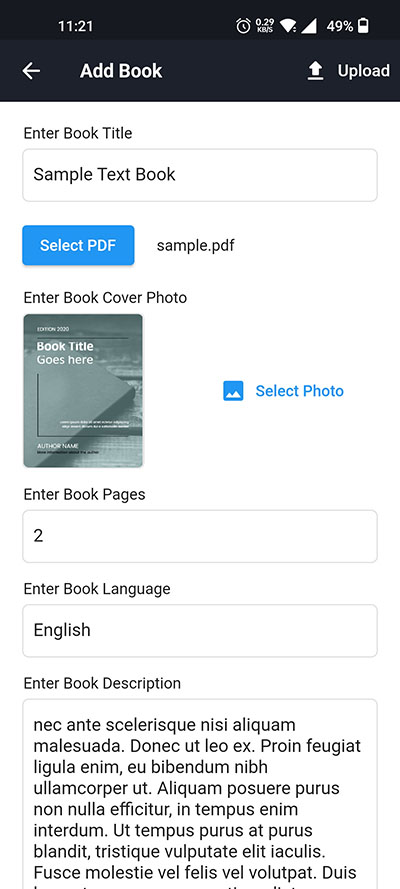
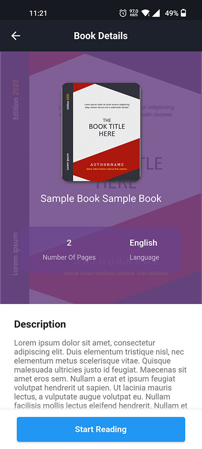
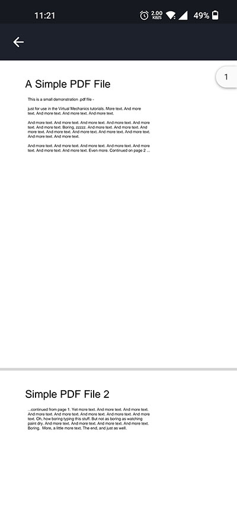

<div align="center">

# 📚 Hasper EBook Admin

**A modern administrative panel for managing the Hasper EBook digital library**

Built with ❤️ using Dart & Flutter


[](https://flutter.dev)
[](https://dart.dev)
[](https://firebase.google.com)
[](LICENSE)

### 🎯 [CI/CD Documentation](.github/ARCHITECTURE.md)

### 🌐 [Live Preview on Appetize](https://appetize.io/app/qqkmw4er34ynubm4bcgiw54blm)

Try the app instantly in your browser - no installation required!

[](https://github.com/Rezuanul-Islam-Fahim/hasper_ebook_admin/stargazers)
[](https://github.com/Rezuanul-Islam-Fahim/hasper_ebook_admin/network/members)
[](https://github.com/Rezuanul-Islam-Fahim/hasper_ebook_admin/watchers)

</div>

---

## 🎯 About

**Hasper eBook Admin** is a comprehensive administrative application for managing the Hasper eBook digital library. This Flutter-based admin panel provides content managers with powerful tools to add, edit, and organize e-books in the collection.

### ✨ Key Features

- 📱 **Cross-Platform**: Native performance on Android, iOS, and Web
- ☁️ **Cloud-Powered**: Real-time synchronization with Firebase Firestore and Storage
- 📄 **PDF Management**: Upload and preview PDFs before publishing
- 🖼️ **Image Handling**: Easy cover photo selection and upload
- 🔍 **Smart Search**: Quickly find and edit books
- ♾️ **Infinite Scrolling**: Manage large catalogs efficiently
- 🚀 **CI/CD Pipeline**: Automated builds and deployments with GitHub Actions

### 🚀 CI/CD Integration

This project includes a comprehensive GitHub Actions workflow that automatically:
- ✅ Builds release APKs on pull requests
- ✅ Configures Firebase automatically
- ✅ Uploads APKs as downloadable artifacts
- ✅ Deploys to Appetize.io for instant browser testing
- ✅ Speeds up builds with intelligent caching

**For detailed CI/CD setup and architecture, see [.github/ARCHITECTURE.md](.github/ARCHITECTURE.md)**

---

## 📸 Screenshots

<div align="center">

<p>
   &nbsp;
   &nbsp;
  
</p>

<p>
   &nbsp;
   &nbsp;
  
</p>

</div>

---

## 🛠️ Tech Stack

### Core Technologies
- **Flutter** `^3.5.0` - Cross-platform UI framework
- **Dart** `^3.5.0` - Programming language
- **Firebase Core** `^3.9.0` - Firebase SDK
- **Cloud Firestore** `^5.6.12` - NoSQL database
- **Firebase Storage** `^12.4.0` - Cloud file storage

### Key Features
- **Provider** `^6.1.2` - State management
- **File Picker** `^8.1.6` - PDF file selection
- **Image Picker** `^1.1.2` - Cover image selection
- **Syncfusion PDF Viewer** `^28.1.36` - PDF preview
- **Infinite Scroll Pagination** `^4.1.0` - Efficient list loading
- **Connectivity Plus** `^6.1.1` - Network monitoring

---

## 🚀 Getting Started

### Prerequisites

- Flutter SDK (3.5.0+)
- Dart SDK (3.5.0+)
- Firebase account
- Android Studio or VS Code

### Installation

1. Clone the repository:
```bash
git clone https://github.com/Rezuanul-Islam-Fahim/hasper_ebook_admin.git
cd hasper_ebook_admin
```

2. Install dependencies:
```bash
flutter pub get
```

3. Configure Firebase:
```bash
# Install FlutterFire CLI
dart pub global activate flutterfire_cli

# Configure Firebase
flutterfire configure --project=hasper-ebook
```

4. Run the app:
```bash
flutter run
```

### CI/CD Setup

To enable automated builds and deployments:

1. Add GitHub repository secrets:
   - `FIREBASE_TOKEN` - Get with: `firebase login:ci`
   - `FIREBASE_PROJECT_ID` - Your Firebase project ID
   - `APPETIZE_API_TOKEN` - From Appetize.io

2. Create a PR to `master` or `main` branch

3. Workflow builds and deploys automatically

For detailed setup instructions, see [.github/ARCHITECTURE.md](.github/ARCHITECTURE.md)

---

## 📁 Project Structure

```
lib/
├── components/          # Reusable UI components
├── models/             # Data models
├── providers/          # State management
├── repositories/       # Data access layer
├── screens/           # Application screens
├── utils/             # Utility functions
└── main.dart          # Entry point
```

---

## 🤝 Contributing

Contributions are welcome! Please feel free to submit a Pull Request.

---

## 📚 Related Projects

- **[Hasper eBook](https://github.com/Rezuanul-Islam-Fahim/hasper_ebook)** - The main user-facing e-book reader application

---

## License

```
MIT License

Copyright (c) 2022 Rezuanul Islam Fahim

Permission is hereby granted, free of charge, to any person obtaining a copy
of this software and associated documentation files (the "Software"), to deal
in the Software without restriction, including without limitation the rights
to use, copy, modify, merge, publish, distribute, sublicense, and/or sell
copies of the Software, and to permit persons to whom the Software is
furnished to do so, subject to the following conditions:

The above copyright notice and this permission notice shall be included in all
copies or substantial portions of the Software.

THE SOFTWARE IS PROVIDED "AS IS", WITHOUT WARRANTY OF ANY KIND, EXPRESS OR
IMPLIED, INCLUDING BUT NOT LIMITED TO THE WARRANTIES OF MERCHANTABILITY,
FITNESS FOR A PARTICULAR PURPOSE AND NONINFRINGEMENT. IN NO EVENT SHALL THE
AUTHORS OR COPYRIGHT HOLDERS BE LIABLE FOR ANY CLAIM, DAMAGES OR OTHER
LIABILITY, WHETHER IN AN ACTION OF CONTRACT, TORT OR OTHERWISE, ARISING FROM,
OUT OF OR IN CONNECTION WITH THE SOFTWARE OR THE USE OR OTHER DEALINGS IN THE
SOFTWARE.
```